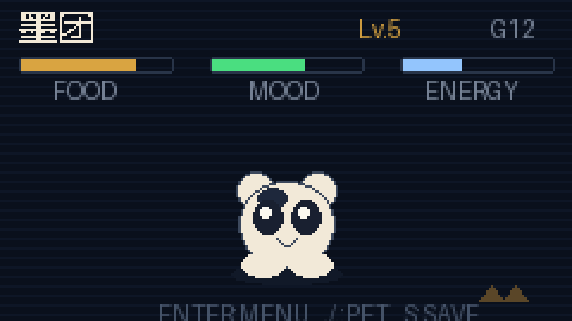

# Cardputer ADV 五件套：答案之书 / 易经 / 二选一 / 口袋宠物 / 骰子硬币

五个可以装进 **M5Launcher** 的独立应用，共用一套显示 / 键盘 / 字体 / 摇一摇基础设施：

| 应用 | 说明 |
|---|---|
| **答案之书** `answer-book` | 分类求签 + 摇一摇翻书 + 追问一次 + SD 主题答案包 |
| **易经 · 六爻** `iching` | 三枚铜钱掷六次，本卦 + 动爻 + 之卦 |
| **二选一决策器** `decider` | 两个选项放上天平，给出倾向与一句理由 |
| **口袋宠物** `pocketpet` | 原创 32×32 像素宠物：墨丸 → 砚兽 → 墨麟，养成 / 小游戏 / 对战 / 进化 / 存档 |
| **骰子与硬币** `dice` | 摇一摇或按键掷 1–3 颗骰子、抛硬币，带统计与持久化 |

五个都是离线应用：不联网、不依赖 SD 卡（答案包的 SD 功能除外），插不插卡都能启动。




---

## 1. 目录

```
answer-book/
├── platformio.ini          # 五个 env：answer-book / iching / decider / pocketpet / dice
├── dist/                   # 已编译好的五个 bin
├── sdcard/answerbook/      # 主题答案包示例，拷到 SD 卡即可
├── tools/
│   ├── gen_font.py         # 扫源码 + GB2312 一级字库 → src/core/font_data.h
│   ├── gen_hexagrams.py    # 64 卦数据表
│   ├── gen_sprites.py      # 32x32 像素精灵 → sprites.h
│   ├── mock_ui.py          # 电脑上 1:1 模拟界面
│   └── mock_pet.py         # 宠物界面 1:1 预览
└── src/
    ├── core/               # 共用：字体渲染、TCA8418 键盘、画布/声音/摇一摇
    └── apps/
        ├── answer_book/    # 答案之书
        ├── iching/         # 易经六爻
        ├── decider/        # 二选一
        ├── pocketpet/      # 口袋宠物
        └── dice/           # 骰子与硬币
```

---

## 2. 五个应用怎么玩

### 2.1 答案之书

| 按键 | 作用 |
|---|---|
| `Enter` / `Space` / **摇一摇** | 翻开 |
| `1`–`9` | 换主题：爱情/事业/学业/财运/健康/人际/出行/选择/随便 |
| `Space`（答案页） | 追问一次（再按收起；同一签只给一次） |
| `,` `.` `;` `/` | 翻书记录 |
| `S` | 设置（音效/动画/亮度/答案包/版本） |
| `` ` `` / `Backspace` | 返回 |

- 每个主题有自己的答案池；「随便」从全部答案里抽。
- 追问会给一句“为什么”，同一签只能看一次，防止无限重抽。
- 答案包：设置 → 答案包 → 循环切换（内置 → SD 上的包）。

### 2.2 易经 · 六爻

1. 封面按 `Enter`（或摇一摇）起卦。
2. 连按 6 次 `Enter`，每次三枚铜钱：字=3、背=2，和 6/7/8/9 对应老阴/少阳/少阴/老阳。
3. 六爻成卦后显示本卦：卦名、上下卦、一句断语。
4. 有动爻时按 `Space` 看之卦；`Enter` 再起一卦。

### 2.3 口袋宠物（墨丸 → 砚兽 → 墨麟）

> 原创形象与招式，只借鉴像素宝可梦的造型语言（32×32、1px 描边、左上光源、大头大眼），不复制任何宝可梦角色。

| 按键 | 作用 |
|---|---|
| `Enter` | 打开/确认菜单 |
| `,` `.` `;` `/` | 菜单里移动光标；首页左右键摸摸它 |
| `S`（首页） | 立即存档 |
| `` ` `` | 返回 |

菜单：喂食 / 玩耍 / 训练 / 清洁 / 睡觉 / 外出 / 状态 / 设置。

- **养成**：饱食、心情、精力、清洁、健康、亲密度六项；不照顾会掉心情和健康，便便会降低清洁。
- **玩耍**：20 秒接果子小游戏，左右移动接住落下的果子，得分换心情/经验/金币。
- **训练**：体力（攻击/生命）、智力（招式威力）、敏捷（防御），消耗 10 精力。
- **外出**：65% 遇到野生宝可梦进入回合制战斗，35% 捡到东西。
- **战斗**：招式随阶段变化——墨点/笔锋/墨龙击（普攻）、泼墨（特攻，85% 命中，耗精力）、静心（回复）或砚甲（3 回合减伤）、逃跑。
- **进化**：Lv.10 墨丸 → 砚兽，Lv.25 → 墨麟，进化回满健康。
- **难度**：设置里可切 普通 / 困难；**默认困难**——敌人等级高 2~5 级、血量 +8、AI 更爱回复和放特攻。
- **连战**：赢了有 45% 概率可以直接接下一只（等级再 +1），最多连 4 场，奖励递增。
- **图鉴**：状态页按右键查看三种形态的解锁条件。
- **存档**：NVS，自动每 15 秒存一次；关机再开会按“睡了一觉”结算少量衰减。
- **命名**：设置 → 改名（键盘只能输入字母数字）。

### 2.4 骰子与硬币

| 按键 | 作用 |
|---|---|
| `Enter` / `Space` / **摇一摇** | 掷骰子 / 抛硬币 |
| `,` `.` `;` `/`（左右） | 切换「骰子 / 硬币」 |
| 上下 | 骰子模式下改数量（1–3 颗） |
| `H` | 统计页（骰子点数分布 / 硬币正反次数） |
| `S` | 设置（音效 / 亮度） |

- 骰子：1–3 颗，多颗时显示合计；掷动时骰子翻滚，落定有音效。
- 硬币：字 / 花，翻转时用椭圆缩放模拟旋转。
- 统计：每面出现次数、骰子与硬币局数，写入 NVS，重启保留。
- 摇一摇与按键并行，随时都能掷。

### 2.5 二选一决策器

1. 封面按 `1` / `2` 给 A/B 命名（键盘只能输入字母数字，留空用默认「选项一/二」）。
2. `Enter` 开始权衡：天平会向结果倾斜，并给出倾向百分比与一句理由。
3. `Enter` 重新权衡，`Esc` 返回。

> 它只是打破僵局的工具，结果不能替你做决定。

---

## 3. 主题答案包（SD 卡）

把 `.txt` 放进 SD 卡的 `/answerbook/` 目录。文件名就是包名，也可以在第一行用 `#name` 指定。

格式（每行一条，`|` 分隔）：

```
答案文本|追问解释|语气|分类
```

- **语气**：`yes` / `no` / `wait` / `maybe`
- **分类**：`love,work,study,money,health,people,travel,choice`（逗号分隔），或 `all`
- **追问解释**可留空；分类留空默认 `all`

示例：

```
#name 打工人版
先谈钱，再谈理想|不谈，对方就默认你接受。|yes|work
别接这个锅|接了第一次，就会有第二次。|no|work
```

仓库里的 `sdcard/answerbook/打工人版.txt` 可以直接拷过去。

**用字限制**：固件里的字库是 **GB2312 一级常用字（3755 字）+ 项目自身用字**，覆盖日常书写没问题；生僻字会显示成 `?`。如果确实需要，把答案文本临时放进源码跑一次 `tools/gen_font.py` 再编译即可扩展。

---

## 4. 装进 Launcher

三个 bin 都在 `dist/`：

```
AnswerBook_CardputerADV_v1.2.1.bin
IChing_CardputerADV_v1.0.1.bin
Decider_CardputerADV_v1.0.bin
PocketPet_CardputerADV_v1.0.bin
Dice_CardputerADV_v1.0.bin
```

拷到 SD 卡的 `/downloads/`，设备上进 **Launcher → SD → downloads**，逐个 Install。也可以用 Launcher 的 WebUI 上传。

五个应用彼此独立，Launcher 里会显示成五个条目；每个约 1MB。

> **Flash 预算提醒**：8MB 里 Launcher 自己占 1.31MB，Bruce 占 4.35MB，剩下约 2.2MB，只够装 **两个** 1MB 级应用。想装第三个/第四个，先删掉 Bruce 或在 Launcher 里删除旧版本的重复条目（每次 Install 都会新建分区，不会覆盖）。

**退出应用**：按 `RST`。你的 Launcher 是 `bootToApp=false`，重启会停在启动画面。

---

## 5. 编译

```bash
# 生成字库（改了任何中文文案后都要重跑）
python tools/gen_font.py

# 一次编译三个应用
pio run
```

只编某一个：

```bash
pio run -e answer-book
pio run -e iching
pio run -e decider
```

产物：

```
.pio/build/answer-book/firmware.bin
.pio/build/iching/firmware.bin
.pio/build/decider/firmware.bin
```

三个都是**普通 app 镜像**（0xE9 开头、0x10000 基址），交给 Launcher 即可，不要合并 bootloader。

### 体积（实测）

| 应用 | bin | Flash |
|---|---|---|
| 答案之书 v1.2.1 | 1,089,472 B | 1,089,105 B（32.6%） |
| 易经 · 六爻 v1.0.1 | 1,027,136 B | 1,026,777 B（30.7%） |
| 二选一 | 1,031,168 B | 1,030,801 B（30.8%） |
| 口袋宠物 v1.0 | 1,046,128 B | 1,045,765 B（31.3%） |
| 骰子与硬币 v1.0 | 1,029,504 B | 1,029,137 B（30.8%） |

其中字库约 435KB（16px + 24px，3872 个字符）——这是为了让 SD 答案包能写常用汉字。

---

## 6. 关键实现与坑

| 问题 | 结论 |
|---|---|
| Launcher 要什么格式 | 普通 app 镜像（0x10000、写入 OTA 槽），不要合并 bootloader；首次 slot 1.375MB 是上限 |
| 屏幕旋转 | **ADV 面板 offset_rotation = 1，必须 `setRotation(0)`**；写 1 会翻转 180° 且半屏黑 |
| 画布 | `M5Canvas` 默认 `_psram=true`，ADV 无 PSRAM，必须 `setPsram(false)` |
| 键盘 | TCA8418（0x34 / SDA8 / SCL9，7×8）→ 换算成 4×14 逻辑矩阵；轮询 FIFO，不依赖 INT |
| 摇一摇 | BMI270：加速度模长偏离 1g > 0.55g，700ms 内 3 次 → 触发；串口会打印 `shake` 便于调阈值 |
| 字库 | efontCN 编译后 MB 级会超槽 → 子集化；现在用 GB2312 一级 + 源码用字，约 435KB |
| 多应用 | 一个 PlatformIO 工程三个 env，`build_src_filter` 各取所需，共用 `src/core` |

---

## 7. 排障

- **黑屏**：先看串口（USB CDC，115200）的 `board/rot/分辨率`；确认 `rot=0`、`240x135`。
- **键盘无反应**：串口看 `kb=1`；为 0 说明 TCA8418 初始化失败。
- **摇一摇太灵敏/不灵**：改 `src/core/ui.cpp` 里 `dev > 0.55f` 和 `_cross >= 3`，重新编译。
- **答案包不出现**：确认路径是 `/answerbook/*.txt`、UTF-8 编码、文件是 FAT32 可读；启动时会扫描一次，插卡后需重启。
- **答案包里的字显示 `?`**：生僻字不在字库，见第 3 节。
- **v1.2.1 修正**：折行绘制原来会把整段后半部分重复画到每一行（易经的断语、答案之书的追问看起来“显示不全/叠字”）；现在按行长度绘制。

---

## 8. 授权提示（重要）

- 本项目的**代码**可自由参考、修改、用于个人学习。
- **`src/core/font_data.h` 不在此列**：它是由 Windows 自带的「微软雅黑」子集化得到的点阵数据，属于字体衍生内容。仓库公开只是为了方便交流，**请勿将其用于商业分发**。
- 需要干净授权时，把 `tools/gen_font.py` 里的 `FONT_CANDIDATES` 换成开源字体（本机已有 `C:\Windows\Fonts\NotoSansSC-VF.ttf`，SIL OFL 1.1），重跑脚本并重新编译即可。
