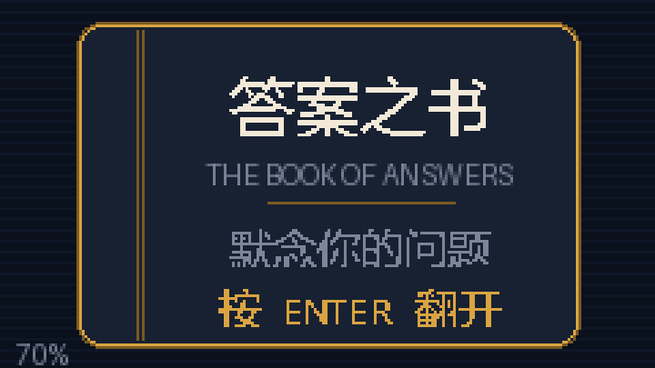
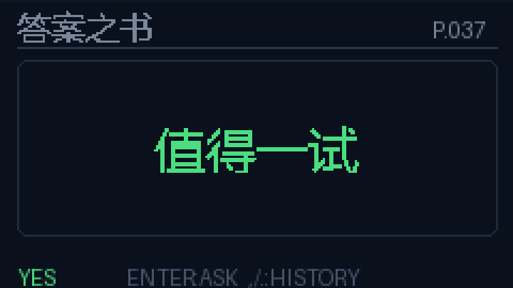

# 答案之书 · Cardputer ADV

把纸质《答案之书》做成 Cardputer ADV 上的一个独立应用：心里默念一个只能用「是/否/要不要」回答的问题，按 Enter 翻书，得到一个答案。

产物是一个标准 Arduino app 镜像 `firmware.bin`，可以直接放进 **M5Launcher** 安装并从 Launcher 菜单启动，不改动 Bruce、不占用 SD 卡、不需要联网。




> 上面两张图由 `tools/mock_ui.py` 用固件里同一份点阵数据渲染，尺寸就是 240×135。

---

## 1. 效果与操作

| 按键 | 作用 |
|---|---|
| `Enter` / 空格 | 提问（封面上是「翻开」，答案页是「再问一次」） |
| `,` `.` / `;` `/` | 打开翻书记录（ADV 上这四颗就是方向键） |
| `S` | 设置 |
| `` ` `` / `Backspace` | 返回上一层 |

界面三块：

1. **封面**：书名、英文副标题、闪烁提示、电量。
2. **洗牌**：1~2.4 秒的翻书动画，字符从左到右逐字定格，页码同时乱跳，带轻微「嗒嗒」声。
3. **答案页**：24px 大字 + 页码 + 语气色（绿=肯定、红=否定、黄=等一等、蓝=看情况）+ 英文语气词。

设置项：音效开关、动画速度（快/中/慢）、亮度（20%~100%），写入 NVS，重启后保留。

---

## 2. 三个关键设计取舍

### 2.1 为什么不直接用 M5GFX 的 `efontCN`
`lgfx_efont_cn.c` 编译后是 MB 级体积，而 Launcher 首次给应用分配的 OTA 槽只有 **0x150000 = 1.375MB**。本项目的答案库只用到 233 个汉字，于是用 `tools/gen_font.py` 把源码里出现过的字符做成 16px + 24px 两套 1-bit 点阵：

- 16px：约 8.8KB 位图
- 24px：约 20.8KB 位图
- 合计不到 40KB，换来了大字号和干净的排版

生成脚本会扫描 `src/` 下所有源码（跳过注释），所以**改了答案库之后重跑一次脚本**即可，不用手动维护字表。

### 2.2 键盘为什么自己写
ADV 的键盘是 TCA8418（I2C 0x34，7 行 × 8 列），和初代 Cardputer 的直接 GPIO 矩阵完全不同。这里没有用 `M5Cardputer` 库（它会连带拉进 IRremote、LibSSH 等依赖），而是：

- 用 `m5::In_I2C`（M5Unified 已经初始化好的内部 I2C，8/9）直接读 TCA8418；
- **轮询 FIFO，不依赖 INT 引脚**（Launcher 的移植记录里提到过 INT 不工作的板子）；
- 把 7×8 物理坐标换算成初代 Cardputer 的 4×14 逻辑矩阵，键位表与官方一致。

### 2.3 为什么完全不碰 SD 卡和 PSRAM
- 答案是 `const` 数组，直接留在 Flash，插拔 SD 不影响启动；
- 全屏画布 240×135×16bpp ≈ 65KB，内部 RAM 够用，因此 `platformio.ini` 里**没有**打开 PSRAM（ADV 本来也没有）。

---

## 3. 目录

```
answer-book/
├── platformio.ini
├── README.md
├── tools/
│   ├── gen_font.py        # 扫描源码 → 生成 src/font_data.h
│   ├── mock_ui.py         # 用同一份点阵在电脑上 1:1 模拟界面（改版式时先看这个）
│   ├── preview.png        # 16px 点阵预览（自检用）
│   ├── preview_24.png     # 24px 点阵预览
│   ├── screen_cover.png   # 封面效果图
│   └── screen_answer.png  # 答案页效果图
└── src/
    ├── main.cpp           # 状态机 + 全部界面
    ├── answers.h          # 120 条内置答案
    ├── cjk_font.h/.cpp    # UTF-8 解码、点阵绘制、按宽折行
    ├── font_data.h        # 自动生成，勿手改
    └── keyboard_adv.h/.cpp# TCA8418 轮询驱动
```

---

## 4. 编译

需要 PlatformIO Core。通用写法：

```bash
# 改了答案库或界面文案后，先重生成字库（需要 Pillow + 一款中文字体）
python tools/gen_font.py

# 编译
pio run -e cardputer-adv
```

Windows 上如果和我一样把工具装在独立 conda 环境里，则是：

```bash
"E:/13.miniconda/envs/mylearning/python.exe" tools/gen_font.py
"E:/13.miniconda/envs/pio-cardputer/python.exe" -m platformio run -e cardputer-adv
```

产物（本机已实测编译通过）：

```
.pio/build/cardputer-adv/firmware.bin   578,320 字节
```

镜像头是 `E9 05 02 3F …`，即标准 ESP32-S3 app image，可直接交给 Launcher。

> 注意：`firmware.bin` 是**单纯的 app 镜像**（起始 0x10000），不是合并镜像。给 Launcher 用就传这个文件，不要自己 merge bootloader，也不要烧到 0x0。

---

## 5. 装进 Launcher

**已经编译好的成品**：`dist/AnswerBook_CardputerADV_v1.0.bin`（578,320 字节）。直接用它，不需要重新编译。

三种方式任选：

1. **SD 卡（最稳）**：把 `firmware.bin` 拷到 SD 卡（你当前配置的下载目录是 `/downloads/`），设备上进 `Launcher → SD`，选中 `.bin` → Install。
2. **WebUI**：Launcher 里开 `WUI`，电脑/手机连上后打开网页，`OTA Update` 上传 bin。
3. **OTA**：把 bin 放到任意直链（GitHub Release 等），Launcher 的 `OTA` 里填 URL。

安装时 Launcher 会自己决定装进哪个 OTA 槽、必要时重排分区。本固件实测 **578,320 字节（约 565KB）**，默认 1.375MB 的槽放得下：

```
RAM:   7.2% (23,500 / 327,680 bytes)
Flash: 17.3% (577,949 / 3,342,336 bytes)
```

**退出应用**：按设备侧面的 `RST`。你的 Launcher 是 `bootToApp=false`，重启后会停在 Launcher 启动画面，按 `Enter` 进菜单。如果某次直接进了 App，开机时按住 `G0`（侧键）再点 RST 即可强制进 Launcher。

---

## 6. 已知限制 / 排障

- **尚未在真机上验证**（代码已通过编译）。如果键盘完全没反应，优先怀疑两点：
  1. TCA8418 没被识别：开机串口应能看到 `M5.In_I2C.scanID(0x34)` 失败；
  2. 你的 ADV 批次 INT 引脚接了但 FIFO 行为不同：把 `keyboard_adv.cpp` 里的轮询改成读取 `REG_KEY_LCK` 计数后再读事件。
- 答案页最多排 3 行 × 9 个汉字；答案库里目前都 ≤ 9 字，所以永远是一行。想加长答案时注意 `drawAnswerFrame()` 里的行高与起始 Y。
- 音量固定 55，跟系统音量无关；ES8311 的 tone 很短，不会打断音乐（本应用也不放音乐）。
- 深色主题是写死的，没有做主题切换。

---

## 7. 可以继续玩的

- **SD 卡外挂答案库**：`/answerbook/answers.txt`，一行一条，支持自己写「毒舌版」「恋爱版」答案包；
- **IMU 摇一摇**：BMI270 检测晃动 → 直接换一条答案，比按键更有仪式感；
- **麦克风**：拍手/吹气触发（不需要识别内容，只做能量阈值）；
- **红外**：把答案用 IR 发出去，或做成「问电视」的彩蛋；
- **双语**：给 `Answer` 加 `en` 字段，`S` 键切换；
- **开机动画**：Launcher 支持 boot image，可以配一张同风格的书封。

---

## 8. 出处与致谢

- 交互形态致敬 Carol Bolt 的 *The Book of Answers*；
- 键盘坐标换算参考 M5Stack `M5Cardputer` 库（MIT）与 `bmorcelli/Launcher` 的 ADV 移植笔记；
- `M5Unified` / `M5GFX` 均为 MIT。

---

## 9. 授权提示（重要）

- 本项目的**代码**可自由参考、修改、用于个人学习。
- **`src/font_data.h` 不在此列**：它是由 Windows 自带的「微软雅黑」子集化得到的点阵数据，属于字体衍生内容。仓库公开只是为了方便交流，**请勿将其用于商业分发**。
- 需要干净授权时，把 `tools/gen_font.py` 里的 `FONT_CANDIDATES` 换成开源字体（本机已有 `C:\Windows\Fonts\NotoSansSC-VF.ttf`，SIL OFL 1.1），重跑脚本并重新编译即可：

```bash
"E:/13.miniconda/envs/mylearning/python.exe" tools/gen_font.py
"E:/13.miniconda/envs/pio-cardputer/python.exe" -m platformio run -e cardputer-adv
```
